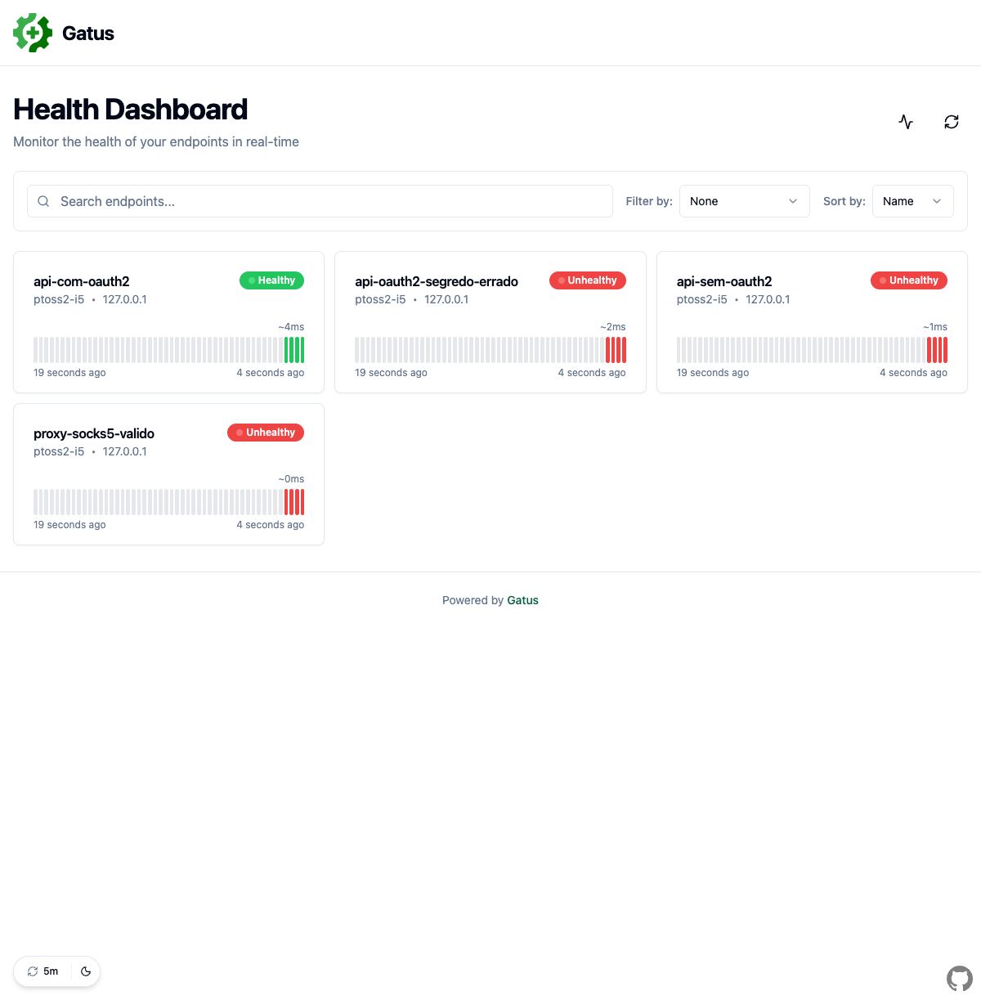

# PTOSS-2 — I5: TDD da validação de `client.Config`

**Responsável:** gccintra · **Branch:** `ptoss2-tdd-i5-client`

## Comportamentos desenvolvidos

Os dois ciclos mudam [`Config.ValidateAndSetDefaults`](../../../client/config.go#L129), que valida o bloco `client` de cada endpoint na carga da configuração (configuração inválida interrompe o início do Gatus).

- **V01:** rejeitar `oauth2` e `identity-aware-proxy` configurados juntos (`ErrInvalidClientOAuth2AndIAPConfig`). Antes, a configuração era aceita e `getHTTPClient` apenas registrava um erro no log e não aplicava **nenhuma** das duas autenticações. Cada opção isolada continua funcionando e mantém seu erro próprio.
- **V02:** rejeitar antecipadamente `proxy-url` malformada, como `://` (`ErrInvalidClientProxyURL`, envolvendo o erro de `url.Parse`). Antes, a URL era aceita e `getHTTPClient` registrava "THIS SHOULD NOT HAPPEN" e **ignorava o proxy em silêncio**, conectando direto. Proxy vazio, `http`, `https`, `socks5` e `socks5h` continuam aceitos.

[Testes](../../../client/config_client_ptoss2_tdd_test.go): configuração em memória, sem rede.

## Ordem combinada

Os ciclos de surpesaiajin (I1) alteram o mesmo arquivo. Por isso esta branch parte de `ptoss2-tdd-i1-resolver` ([`0437dd85`](https://github.com/surpesaiajin/gatus/commit/0437dd85)) e integra a [F5](../f5/README.md) no merge `6f5cc480` antes do primeiro Red. Quando I1 entrar na `ptoss2`, esta branch deve ser integrada depois.

## Histórico dos ciclos

Execuções de **02/11/2026**, Go 1.26.3 darwin/arm64, UTC−03. Números em subtestes.

| Etapa | Revisão | PASS / FAIL | Exit | Resultado |
| --- | --- | --- | --- | --- |
| V01 Red | `a16a59f0` | 5 / 3 | 1 | Conflito aceito (`nil`) ou reportado como erro individual de OAuth2/IAP; 5 controles passam |
| V01 Green | `07f8e61c` | 8 / 0 | 0 | `if HasOAuth2Config() && HasIAPConfig()` antes das validações individuais |
| V02 Red | `709b5521` | 5 / 4 | 1 | `://`, `http://[::1`, porta `abc` e `%zz` aceitos; 5 controles passam |
| V02 Green | `9fdce838` | 9 / 0 | 0 | `url.Parse` em `ValidateAndSetDefaults` quando `ProxyURL != ""` |

Nos dois Reds o commit declara **apenas o erro sentinela** (sem comportamento), para que o teste compile e falhe pela asserção esperada, não por símbolo inexistente. Testes inalterados entre Red e Green. Saídas: [execucoes.txt](evidencias/execucoes.txt).

**Decisão de ordem em V01:** o conflito é verificado antes das validações individuais. OAuth2 inválido + IAP válido reporta o conflito, que é o erro mais fundamental (a combinação nunca é aceita, qualquer que seja o conteúdo).

**Refactor — dispensado, com justificativa:**
- V01 acrescenta um `if` de duas linhas no padrão das verificações vizinhas. O ramo equivalente em `getHTTPClient` foi mantido como defesa, pois `getHTTPClient` pode receber configurações não validadas (ex.: `GetHTTPClient(nil)` usa a padrão); removê-lo mudaria comportamento fora do ciclo.
- V02 repete `url.Parse` em `getHTTPClient`. É o mesmo padrão já adotado para `DNSResolver` (valida na carga, trata de novo defensivamente no uso). Extrair um helper para uma chamada de biblioteca não reduziria complexidade.

## Regressão

- `^TestConfig_` em `./client` no estado final: **16 funções, 91 subtestes PASS**, exit 0 (I1 + F1 + F5 + V01/V02).
- `go test ./config/... ./client/...`: todos os pacotes de `config` OK. Em `./client` a única falha é `TestCheckSSHBanner/no-auth-ssh` (`dial tcp 205.166.94.9:22: connect: operation timed out`), teste de rede contra host externo, sem relação com estas mudanças.

## Cobertura

`-covermode=atomic`, seleção `^TestConfig_`. [Relatório final](evidencias/client-config.cover-func.txt).

| Estado | `ValidateAndSetDefaults` | Pacote `client` |
| --- | --- | --- |
| Antes do TDD (`6f5cc480`) | 76,9% | 12,7% |
| Depois de V02 (`9fdce838`) | 88,9% | 14,2% |

Os novos statements estão 100% cobertos pelos testes de V01/V02. Statements não medem MC/DC.

## Teste ponta a ponta (Playwright)

Binários construídos de `6f5cc480` (antes) e `9fdce838` (depois), com um [mock local](e2e/mock_oauth2.py) que emite token *client credentials* e protege `/api` com Bearer. Configurações em [`e2e/`](e2e/). [Saídas](evidencias/e2e.txt).

| Configuração | Antes | Depois |
| --- | --- | --- |
| [`oauth2-iap.yaml`](e2e/oauth2-iap.yaml) | inicia; log "Both Identity-Aware-Proxy and Oauth2…"; endpoint sem autenticação | **não inicia**: `invalid client configuration: oauth2 and identity-aware-proxy cannot be used at the same time` |
| [`proxy-invalida.yaml`](e2e/proxy-invalida.yaml) | inicia; "Silently ignoring custom proxy"; requisição **sai sem proxy** e dá `success=true` | **não inicia**: `invalid proxy-url: parse "://": missing protocol scheme` |
| [`valid.yaml`](e2e/valid.yaml) | — | inicia normalmente |

Com `valid.yaml`, o dashboard foi aberto no Playwright e a API `/api/v1/endpoints/statuses` conferida: `api-com-oauth2` **Healthy** (200, token obtido), `api-sem-oauth2` Unhealthy (401), `api-oauth2-segredo-errado` Unhealthy (`invalid_client`) e `proxy-socks5-valido` aceito na configuração e usado na conexão (`proxyconnect … connection refused`, sem servidor SOCKS). Ou seja, OAuth2 e SOCKS válidos continuam funcionando.



## Como executar

```sh
go test -mod=readonly -count=1 -timeout=2m -v -run '^TestConfig_PTOSS2_TDD_V0[12]_' ./client
go test -mod=readonly -count=1 -timeout=2m -covermode=atomic -coverprofile=client.cover.out -run '^TestConfig_' ./client
go tool cover -func=client.cover.out
```

E2E: `python3 docs/ptoss2/tdd-i5/e2e/mock_oauth2.py 18081 &`, depois `go build -o gatus . && GATUS_CONFIG_PATH=docs/ptoss2/tdd-i5/e2e/valid.yaml ./gatus` e abrir `http://127.0.0.1:18080`.

## Possível terceiro ciclo

A F5 mostrou (CP12–CP14) que `isValid` verifica só presença: espaços, scope `""` e `token-url` sem formato passam. Validar o formato de `token-url` seria um comportamento distinto; depende de decisão do grupo.

## Apoio de IA

Planejamento das alterações, decisões de comportamento e revisão: gccintra. Implementação, execuções, teste E2E e rascunho deste texto com apoio do Claude Code (Anthropic, Claude Opus 5.5), conferidos por gccintra.
